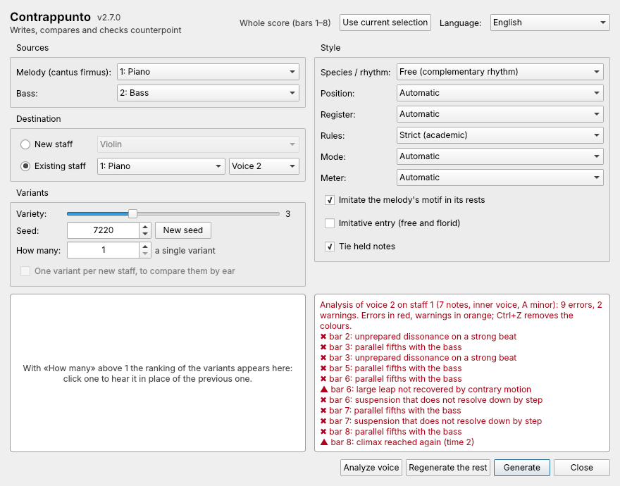

**English** · [Italiano](Controllare-un-esercizio)

# Checking an exercise

**Analyze voice** checks a counterpoint written by hand – your homework, a
student's exercise, a line you are composing – with the same rules the plugin
uses to write. Notes with an **error** turn **red**, notes with a **warning**
turn **orange**, and the window lists every finding with its bar.

## How to

1. Write the cantus firmus (or melody) on one staff and your counterpoint on
   another staff, or in voice 2 of the same staff.
2. Open the plugin. Under **Sources** choose the melody's staff (and the bass,
   if there is one).
3. Under **Destination** choose **Existing staff**, the staff and the **voice**
   of your counterpoint.
4. Choose the **Rules** you are working with (Strict or Free).
5. Press **Analyze voice**.

Correct the notes and press **Analyze voice** again: the colours of the
previous analysis are removed first. **Ctrl+Z** removes the colours straight
away.

## An example

A short exercise with several typical mistakes, coloured as the plugin colours
it (counterpoint above, cantus firmus below):

The analysis reports:

| Bar | | Finding | Why |
|---|---|---|---|
| 2, 3 | ✖ | parallel fifths with the melody | G/C → A/D → B/E: three fifths in a row |
| 4 | ✖ | voice crossing with the melody | the D goes below the cantus firmus's F |
| 4 | ▲ | leap of a sixth (B–D) | in strict style only the ascending minor sixth is allowed |
| 5 | ✖ | forbidden leap (D–C) | a seventh |
| 5 | ▲ | large leap not recovered by contrary motion | after the sixth down comes another leap instead of a step up |
| 7 | ▲ | climax reached again | the high C is touched twice |

Every rule is explained, with what to do about it, in [Analysis
rules](Analysis-rules).

## What the analysis knows

- It finds the key, the chords implied by melody and bass, and which beats are
  strong, as the generator does.
- It recognises passing and neighbour notes, suspensions, cambiatas, double
  neighbours and (with free rules) appoggiaturas, and counts them instead of
  marking them as errors.
- It works on any rhythm, not only on species exercises.

## What it does not do

- It does not judge style or beauty: a line with no errors can still be dull.
  Listen to it.
- It checks **one** voice against melody and bass, not every pair of voices of
  a four-part chorale.
- Rules of a specific textbook may differ in details (some allow the
  ascending major sixth, some forbid any repeated note). Use Free rules for a
  more permissive check.
