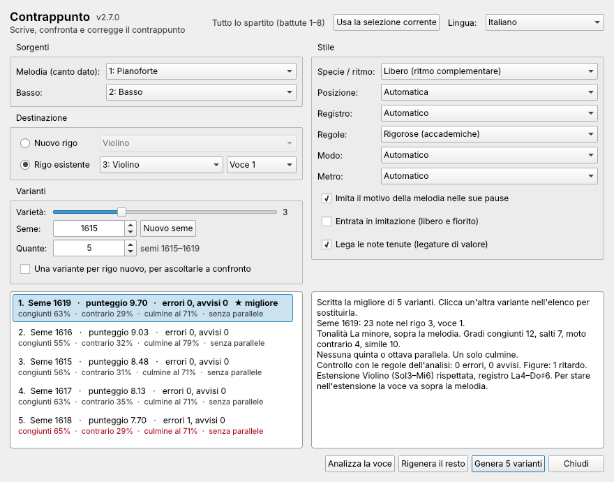

[English](Comparing-variants) · **Italiano**

# Confrontare le varianti

Non esiste un solo contrappunto giusto. Il plugin può calcolare più soluzioni e
ordinarle, così puoi scegliere a orecchio.

## Seme e Varietà

Ogni soluzione è identificata dal suo **seme**, un numero. Con le stesse
impostazioni e lo stesso seme ottieni sempre esattamente lo stesso
contrappunto: annota i semi che ti piacciono.

**Varietà** (0–10) decide quanto le soluzioni possono scostarsi da quella "più
corretta". Con 0 ogni seme dà lo stesso risultato; con 3 (il valore iniziale)
le soluzioni differiscono nei dettagli; con 8–10 differiscono molto, a volte al
prezzo di un avviso o due.

## Più varianti nello stesso posto

1. Imposta **Quante** a un numero da 2 a 8. Accanto vedi i semi che verranno
   usati («semi 4326–4330»).
2. Disattiva **Una variante per rigo nuovo**.
3. Premi **Genera N varianti**.

L'elenco a sinistra mostra le varianti **dalla migliore**:

- **prima** quelle senza quinte o ottave parallele,
- **poi** quelle con meno errori trovati dal controllo automatico,
- **poi** quelle con il punteggio delle regole più alto.

Così una variante con un errore (in rosso, come l'ultima nell'immagine) viene
dopo tutte quelle senza errori, anche quando ha un punteggio più alto. Ogni riga
mostra anche la percentuale di gradi congiunti e
di moto contrario, dove cade il culmine e se ci sono parallele; il rosso indica
errori.

La migliore è già scritta nello spartito. **Clicca** un'altra variante per
sostituirla e ascoltarla; il suo seme passa nel campo **Seme**. Ogni
sostituzione si annulla con Ctrl+Z.

## Una variante per rigo

Con **Una variante per rigo nuovo** attiva (si attiva da sola quando Quante è
maggiore di 1), ogni variante va in un rigo nuovo con l'etichetta «Variante N –
seme S». Fai suonare lo spartito, ascoltale una alla volta (silenzia le altre
nel Mixer), tieni quella che preferisci ed elimina gli altri righi, oppure
annulla tutto con Ctrl+Z.

## Consigli

- Le varianti identiche contano una volta sola: se il plugin dice «1 variante
  era identica a un'altra», alza la Varietà.
- Il punteggio dipende dalle impostazioni: confronta solo varianti calcolate
  con le stesse impostazioni.
- Ne hai trovata una che ti piace quasi? [Tieni le note buone e rigenera il
  resto](Mantenere-note-e-rigenerare).
