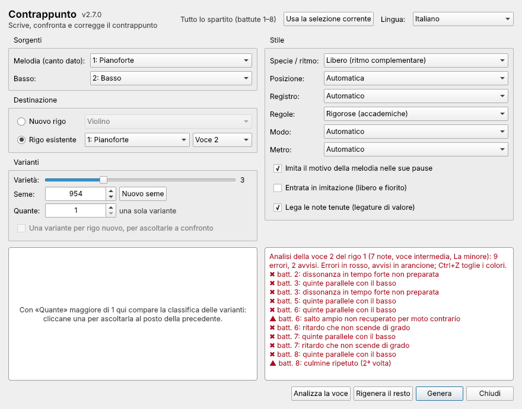
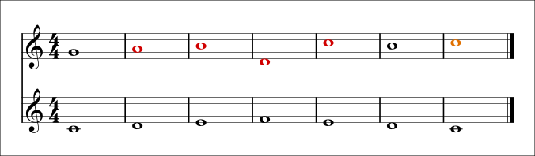

[English](Checking-an-exercise) · **Italiano**

# Controllare un esercizio

**Analizza la voce** controlla un contrappunto scritto a mano – il tuo compito,
l'esercizio di uno studente, una linea che stai componendo – con le stesse
regole che il plugin usa per scrivere. Le note con un **errore** diventano
**rosse**, quelle con un **avviso** **arancioni**, e la finestra elenca ogni
rilievo con la sua battuta.

## Come si fa

1. Scrivi il canto dato (o la melodia) su un rigo e il tuo contrappunto su un
   altro rigo, oppure nella voce 2 dello stesso rigo.
2. Apri il plugin. In **Sorgenti** scegli il rigo della melodia (e quello del
   basso, se c'è).
3. In **Destinazione** scegli **Rigo esistente**, il rigo e la **voce** del tuo
   contrappunto.
4. Scegli le **Regole** con cui lavori (Rigorose o Libere).
5. Premi **Analizza la voce**.

Correggi le note e premi di nuovo **Analizza la voce**: prima vengono tolti i
colori dell'analisi precedente. **Ctrl+Z** toglie i colori subito.

## Un esempio

Un breve esercizio con diversi errori tipici, colorato come lo colora il plugin
(contrappunto sopra, canto dato sotto):

L'analisi segnala:

| Battuta | | Rilievo | Perché |
|---|---|---|---|
| 2, 3 | ✖ | quinte parallele con la melodia | Sol/Do → La/Re → Si/Mi: tre quinte di seguito |
| 4 | ✖ | incrocio delle voci con la melodia | il Re scende sotto il Fa del canto dato |
| 4 | ▲ | salto di sesta (Si–Re) | nello stile rigoroso è ammessa solo la sesta minore ascendente |
| 5 | ✖ | salto non ammesso (Re–Do) | una settima |
| 5 | ▲ | salto ampio non recuperato per moto contrario | dopo la sesta in giù arriva un altro salto invece di un grado in su |
| 7 | ▲ | culmine ripetuto | il Do acuto è toccato due volte |

Ogni regola è spiegata, insieme a che cosa fare, in [Regole
dell'analisi](Regole-dell-analisi).

## Che cosa sa l'analisi

- Trova la tonalità, gli accordi suggeriti da melodia e basso e quali tempi
  sono forti, come fa il generatore.
- Riconosce note di passaggio e di volta, ritardi, cambiate, doppie volte e
  (con le regole libere) appoggiature, e le conta invece di segnarle come
  errori.
- Funziona con qualunque ritmo, non solo con gli esercizi di specie.

## Che cosa non fa

- Non giudica lo stile o la bellezza: una linea senza errori può essere
  comunque piatta. Ascoltala.
- Controlla **una** voce rispetto a melodia e basso, non ogni coppia di voci di
  un corale a quattro parti.
- Le regole di un manuale specifico possono differire nei dettagli (alcuni
  ammettono la sesta maggiore ascendente, altri vietano ogni nota ripetuta).
  Usa le regole Libere per un controllo più permissivo.
