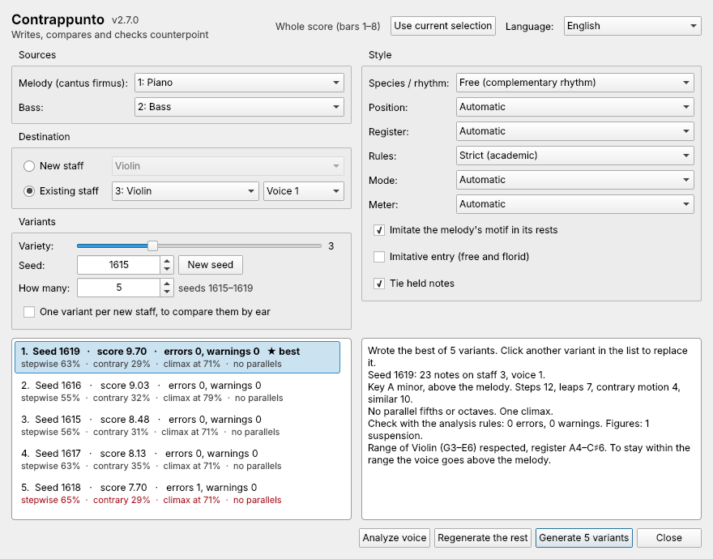

# Contrappunto

**Writes, compares and checks counterpoint** · **Scrive, confronta e corregge il contrappunto**

A plugin for MuseScore 4 that writes a second melody in counterpoint for yours,
checks the counterpoint you write by hand and explains what it finds.

Un plugin per MuseScore 4 che scrive una seconda melodia in contrappunto per la
tua, controlla il contrappunto che scrivi a mano e spiega quello che trova.

| English | Italiano |
|---|---|
| **New to counterpoint?** [Counterpoint in a nutshell](Counterpoint-in-a-nutshell) | **Non conosci il contrappunto?** [Il contrappunto in breve](Il-contrappunto-in-breve) |
| [Installation](Installation) | [Installazione](Installazione) |
| [Quick start](Quick-start) | [Primi passi](Primi-passi) |
| [Choosing a species and style](Choosing-a-species-and-style) | [Scegliere specie e stile](Scegliere-specie-e-stile) |
| [Comparing variants](Comparing-variants) | [Confrontare le varianti](Confrontare-le-varianti) |
| [Checking an exercise](Checking-an-exercise) | [Controllare un esercizio](Controllare-un-esercizio) |
| [Keeping notes and regenerating](Keeping-notes-and-regenerating) | [Mantenere note e rigenerare](Mantenere-note-e-rigenerare) |
| [Writing into an existing staff](Writing-into-an-existing-staff) | [Scrivere in un rigo esistente](Scrivere-in-un-rigo-esistente) |
| [Options reference](Options-reference) | [Opzioni](Opzioni) |
| [Analysis rules](Analysis-rules) | [Regole dell'analisi](Regole-dell-analisi) |
| [Troubleshooting](Troubleshooting) | [Problemi e soluzioni](Problemi-e-soluzioni) |
| [Glossary](Glossary) | [Glossario](Glossario) |
| [Translating](Translating) | [Tradurre](Tradurre) |

Download: [releases](https://github.com/emanuelemerlo/counterpoint/releases) ·
Source: [repository](https://github.com/emanuelemerlo/counterpoint) ·
Bugs and ideas / Segnalazioni: [issues](https://github.com/emanuelemerlo/counterpoint/issues)

These pages are written in the repository (`docs/wiki/`) and published here automatically: to fix one, open a pull request. · Queste pagine si scrivono nel repository (`docs/wiki/`) e vengono pubblicate qui automaticamente: per correggerne una, apri una pull request.
