[English](Counterpoint-in-a-nutshell) · **Italiano**

# Il contrappunto in breve

Per usare il plugin non serve conoscere il contrappunto, ma dieci minuti con
questa pagina ti aiutano a scegliere le opzioni e a capire che cosa ti dice
l'analisi.

## Due melodie insieme

Il **contrappunto** è l'arte di scrivere due o più melodie che suonano nello
stesso momento. Ognuna deve avere senso da sola, e insieme devono suonare bene.
Un canone come *Fra Martino* è l'esempio più semplice; le fughe di Bach sono tra
i più elaborati.

Il contrappunto chiede di guardare la musica in due direzioni:

- in **orizzontale**: ogni voce è una buona melodia, che si muove soprattutto
  per gradi congiunti, con pochi salti "recuperati", un punto culminante e una
  conclusione chiara;
- in **verticale**: in ogni istante le due voci formano un intervallo, e alcuni
  intervalli suonano stabili, altri creano una tensione che deve andare da
  qualche parte.

Contrappunto scrive **una** voce nuova – una *contro-melodia* – per la melodia
che gli dai, e controlla entrambe le direzioni.

## Intervalli consonanti e dissonanti

Un **intervallo** è la distanza tra due note. Alcuni suonano stabili
(**consonanze**):

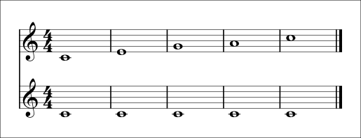

*Unisono, terza, quinta, sesta, ottava. Unisono, quinta e ottava sono
consonanze **perfette**, così aperte e stabili che si usano per cominciare e
finire; terze e seste sono consonanze **imperfette**, più calde e libere.*

Altri suonano tesi (**dissonanze**):

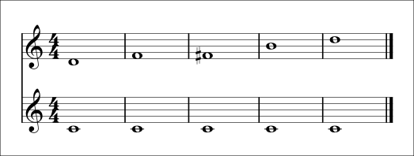

*Seconda, quarta, tritono (quarta eccedente), settima, nona. Nel contrappunto a
due voci la quarta conta come dissonanza rispetto alla voce più grave.*

Le dissonanze non sono vietate: sono loro a far andare avanti la musica. Ma nel
contrappunto ogni dissonanza va **preparata o raggiunta per grado, e
risolta** – vedi più sotto [La dissonanza usata bene](#la-dissonanza-usata-bene).

## Quattro tipi di moto

Quando entrambe le voci si muovono, possono farlo in quattro modi:

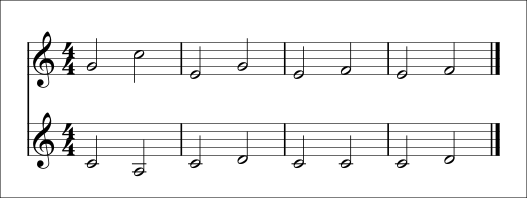

1. **Contrario**: una sale, l'altra scende. Il più indipendente.
2. **Simile**: vanno nella stessa direzione, con intervalli diversi.
3. **Obliquo**: una si muove, l'altra tiene la sua nota.
4. **Parallelo**: vanno nella stessa direzione mantenendo lo stesso intervallo
   (qui terze).

Un buon contrappunto li usa tutti, con una preferenza per il moto contrario,
che mantiene indipendenti le voci.

## Perché si evitano le quinte e le ottave parallele

Due voci che si muovono per **quinte** o **ottave** parallele si fondono così
bene che per un momento non sembrano più due voci, ma una voce sola più spessa.
Il contrappunto è fatto di voci indipendenti, e questa è la regola più famosa
di tutte:

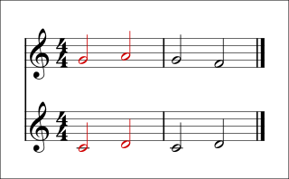

*Battuta 1, in rosso: Do–Sol va a Re–La, due quinte di seguito. Battuta 2: la
voce superiore scende invece di salire, e la quinta diventa una terza.*

Terze e seste parallele vanno bene, con moderazione. Una regola vicina riguarda
le quinte e le ottave **dirette** (o nascoste): arrivare su una quinta o
un'ottava per moto simile, con un salto nella voce superiore, tra le voci
esterne.

## La dissonanza usata bene

Questi sono i modi classici di usare una dissonanza; il plugin li scrive e li
riconosce tutti:

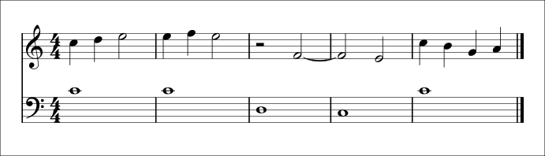

- **Battuta 1 – nota di passaggio**: il Re riempie per grado lo spazio tra Do
  e Mi, su un tempo debole.
- **Battuta 2 – nota di volta**: il Fa si allontana di un grado dal Mi e ci
  torna.
- **Battute 3–4 – ritardo**: il Fa è prima una consonanza (una terza sopra il
  Re, la *preparazione*), viene tenuto mentre il basso va al Do e diventa una
  quarta (la *dissonanza*, sul tempo forte), poi **scende di grado** al Mi, una
  terza (la *risoluzione*). I ritardi sono la 4ª specie.
- **Battuta 5 – cambiata**: dall'ottava Do la voce scende di grado al Si (una
  settima), salta di terza in giù al Sol e risale di grado al La. È l'unica
  figura tradizionale in cui una dissonanza si lascia per salto.

## Il canto dato e le cinque specie

Nel 1725 Johann Joseph Fux pubblicò il *Gradus ad Parnassum*, il manuale su cui
studiarono il contrappunto Haydn, Mozart e Beethoven. Il suo metodo parte da un
**canto dato** (*cantus firmus*), una melodia semplice in note lunghe, e gli
aggiunge una voce sempre più libera nel ritmo: le cinque **specie**.

Questo è il canto dato di Fux, qui in Re minore:

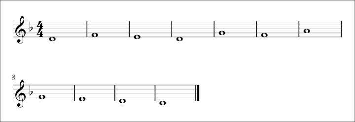

Tutti gli esempi che seguono sono stati **scritti dal plugin** sopra questo
canto dato, con le regole rigorose, esattamente come li vedi.

**1ª specie – nota contro nota (1:1).** Una nota per ogni nota del canto dato,
solo consonanze. Comincia e finisce su una consonanza perfetta e arriva
all'ottava finale attraverso la sensibile (Do♯–Re).

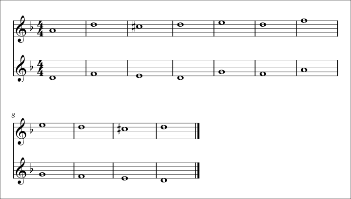

**2ª specie – due note contro una (2:1).** La seconda metà di ogni battuta può
essere una dissonanza, se è una nota di passaggio o di volta.

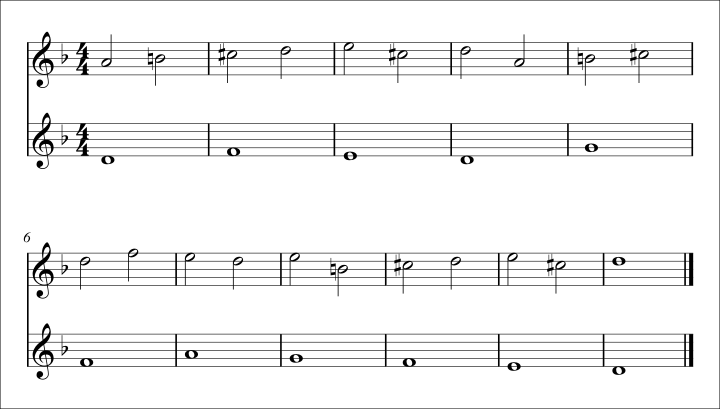

**3ª specie – quattro note contro una (4:1).** Più note di passaggio e di volta,
e le figure della terza specie come la doppia volta.

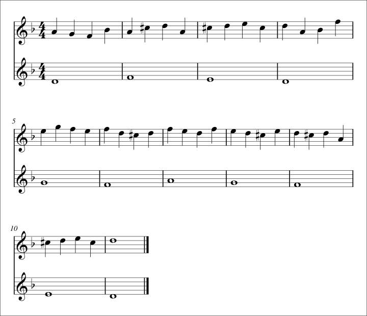

**4ª specie – ritardi.** La voce è spostata di mezza battuta: ogni nota è legata
oltre la stanghetta e, se diventa una dissonanza, scende di grado.

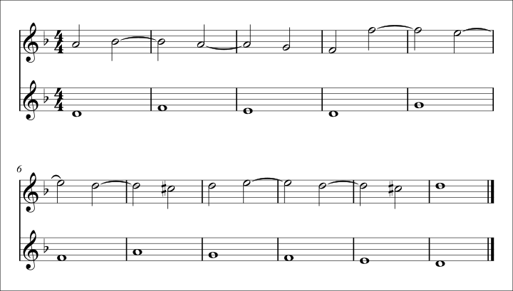

**5ª specie – contrappunto fiorito.** Un insieme delle specie precedenti, con
ritmi vari. È la più vicina alla musica vera.

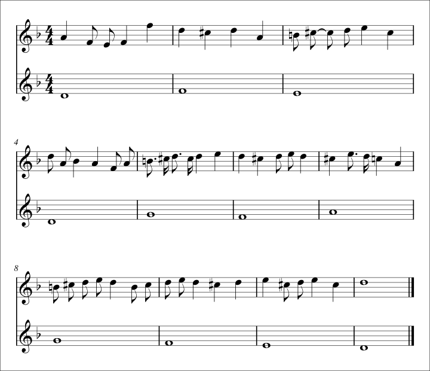

Tutti cominciano su una consonanza perfetta, finiscono sull'ottava e hanno un
solo **culmine**: una nota più acuta di tutte, oltre la metà della frase.

## Oltre gli esercizi

I brani veri non sono fatti di semibrevi. Per una melodia con un suo ritmo – una
canzone, un tema, un pezzo per pianoforte – scegli la specie **Libero**: il
plugin scrive una contro-melodia con un ritmo *complementare* a quello della
melodia (si muove quando la melodia tiene, tiene quando la melodia si muove),
segue l'armonia suggerita da melodia e basso e può **imitare** la melodia:
riprenderne il motivo nelle pause, oppure entrare dopo di lei ripetendone
l'inizio.

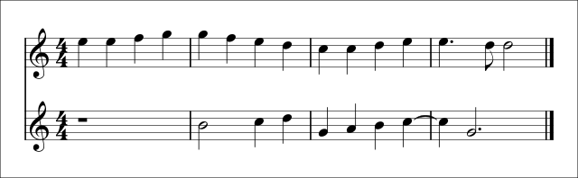

*Entrata in imitazione: la voce inferiore aspetta una battuta, poi ripete
l'inizio della melodia una quinta sotto (Mi Mi Fa Sol → Si Si Do Re: la nota
ripetuta diventa una nota lunga).*

## Dove andare adesso

- [Primi passi](Primi-passi): il tuo primo contrappunto in due minuti.
- [Scegliere specie e stile](Scegliere-specie-e-stile): quali opzioni usare per
  un esercizio, una canzone o un brano per pianoforte.
- [Regole dell'analisi](Regole-dell-analisi): ogni regola che il plugin
  controlla, e che cosa fare.
- [Glossario](Glossario): i termini di questa pagina, in italiano e in inglese.

**Per approfondire**: J. J. Fux, *Gradus ad Parnassum* (1725); K. Jeppesen,
*Counterpoint*; P. Schubert, *Modal Counterpoint, Renaissance Style*.
